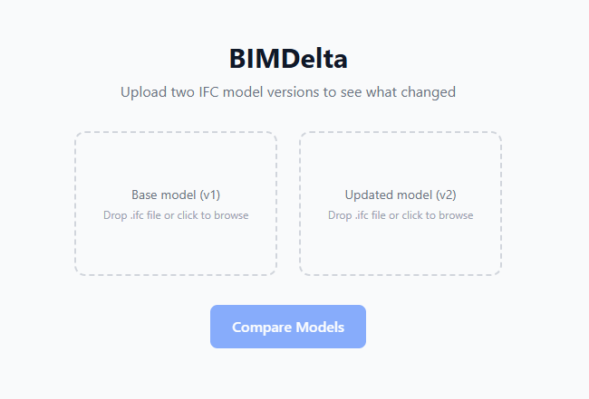
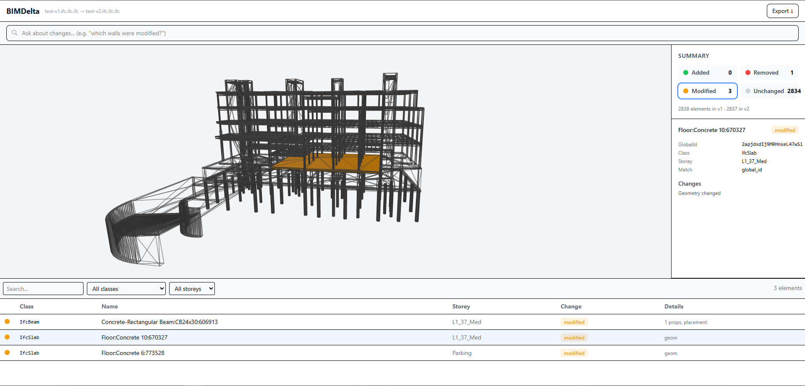
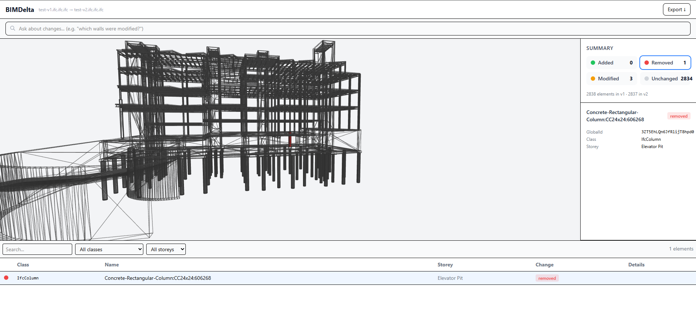
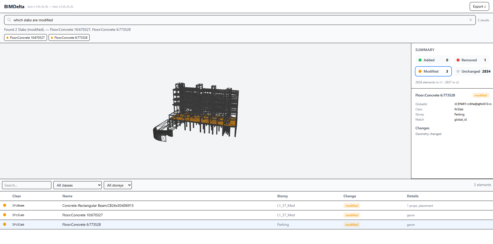
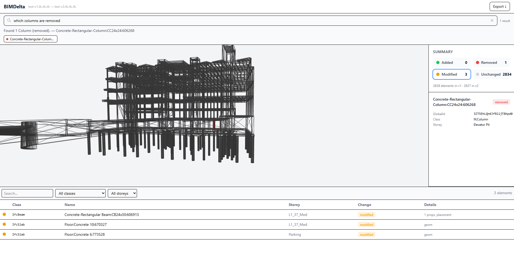
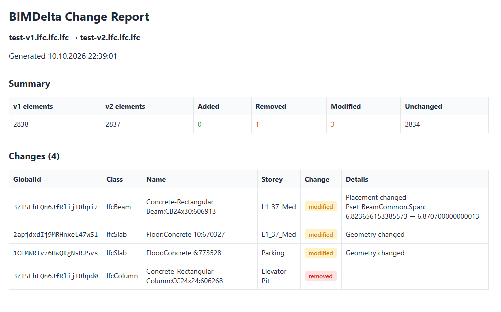

<p align="center">
  <h1 align="center">BIMDelta</h1>
  <p align="center">
    Compare two IFC building models and visualise every change in an interactive 3D viewer.
  </p>
</p>

<p align="center">
  <a href="https://www.youtube.com/watch?v=vahFeB2o-zM">Video Demo</a>
</p>

<p align="center">
  <a href="https://bimdelta.vercel.app/">Demo Website</a>
</p>

<p align="center">
  
</p>

Upload a base model and an updated model — BIMDelta parses both IFC files, matches elements by GlobalId (with placement-based fallback), and classifies every element as **added**, **removed**, **modified**, or **unchanged**. Results are rendered in a colour-coded 3D scene where you can click any element to isolate it, inspect property-level changes, and query the diff in natural language.

## Screenshots

<table>
  <tr>
    <td width="50%">
      
      <p align="center"><strong>Upload</strong> — drag & drop two IFC files</p>
    </td>
    <td width="50%">
      
      <p align="center"><strong>Isolate</strong> — click to highlight with outline</p>
    </td>
  </tr>
  <tr>
    <td width="50%">
      
      <p align="center"><strong>Removed</strong> — shown at original position in red</p>
    </td>
    <td width="50%">
      
      <p align="center"><strong>Query</strong> — ask "which slabs are modified?"</p>
    </td>
  </tr>
  <tr>
    <td width="50%">
      
      <p align="center"><strong>Query</strong> — "which columns are removed?"</p>
    </td>
    <td width="50%">
      
      <p align="center"><strong>Export</strong> — downloadable HTML change report</p>
    </td>
  </tr>
</table>

## Features

- **IFC diff engine** — compares properties, placement, type, and geometry with configurable tolerances
- **3D colour-coded viewer** — merged single-mesh rendering for 60 fps on large models (2800+ elements)
- **Element isolation** — click any element to isolate it with solid fill and black outline
- **Removed element visualisation** — removed elements shown as red ghosts at their original position
- **Natural-language query** — ask questions like *"which walls were modified?"* or *"show removed columns"*
- **Change summary** — breakdown by IFC class and storey, filterable element table
- **HTML export** — download a standalone change report
- **Performance optimised** — parallel IFC parsing, lazy geometry, batch tessellation, pre-allocated typed arrays

## Tech Stack

| Layer    | Stack                                                  |
|----------|--------------------------------------------------------|
| Backend  | Python 3.12 · FastAPI · IfcOpenShell · NumPy           |
| Frontend | React 19 · TypeScript · Vite · Tailwind CSS v4 · three.js · web-ifc · Zustand |
| Infra    | Docker · GitHub Actions CI                             |

## Quick Start

### Backend

```bash
cd backend
python -m venv .venv
.venv/Scripts/activate   # Windows
# source .venv/bin/activate  # macOS/Linux
pip install ".[dev]"
uvicorn app.main:app --port 8001
```

### Frontend

```bash
cd frontend
npm install
npm run dev
```

Open http://localhost:5173 — the dev server proxies `/api` requests to the backend on port 8001.

### Docker

```bash
docker compose up --build
```

Frontend on http://localhost:3000, backend on http://localhost:8001.

## Deploy

### Frontend → Vercel

1. Import the repo on [vercel.com](https://vercel.com)
2. Set **Root Directory** to `frontend`
3. Set **Build Command** to `npm run build`
4. Set **Output Directory** to `dist`
5. Add environment variable `VITE_API_URL` with your backend URL

### Backend → Render

1. Create a new **Web Service** on [render.com](https://render.com)
2. Connect the repo, set **Root Directory** to `backend`
3. Select **Docker** runtime
4. Set **Health Check Path** to `/api/health`

## Project Structure

```
backend/
  app/
    api/          # FastAPI routes
    diff/         # Diff engine (parser, matcher, comparator, geometry)
    schemas/      # Pydantic response models
    config.py     # Settings & tolerances
    main.py       # App entrypoint
  tests/          # Pytest suite
  Dockerfile

frontend/
  src/
    api/          # API client
    components/   # Viewer3D, QueryBar, ChangeTable, DetailPanel, etc.
    store/        # Zustand state management
    types/        # TypeScript interfaces
    utils/        # IFC loader, query engine, colour maps
  Dockerfile
```

## How It Works

1. **Parse** — both IFC files are parsed in parallel using IfcOpenShell, extracting elements, properties, placements, and storey assignments
2. **Match** — elements are matched between versions by GlobalId; unmatched elements use a placement-based fallback within 50mm tolerance
3. **Compare** — matched pairs are diffed across properties, placement matrices, type names, and geometry signatures (bounding box + volume)
4. **Render** — the frontend merges all element geometry into a single three.js mesh with per-vertex colours for 60 fps rendering at any model size

## API

| Endpoint | Method | Description |
|----------|--------|-------------|
| `/api/diff` | `POST` | Upload two IFC files (multipart `v1`, `v2`), returns full diff JSON |
| `/api/health` | `GET` | Health check — `{"status": "ok"}` |

## License

MIT
