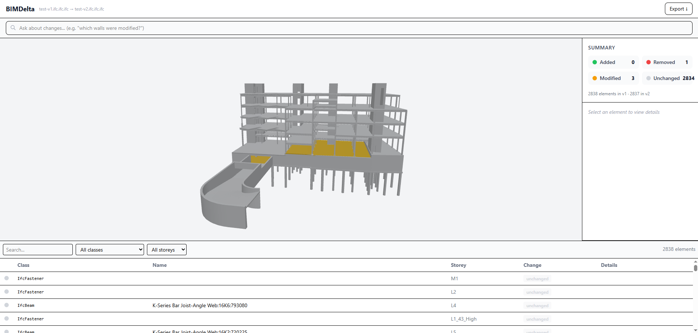
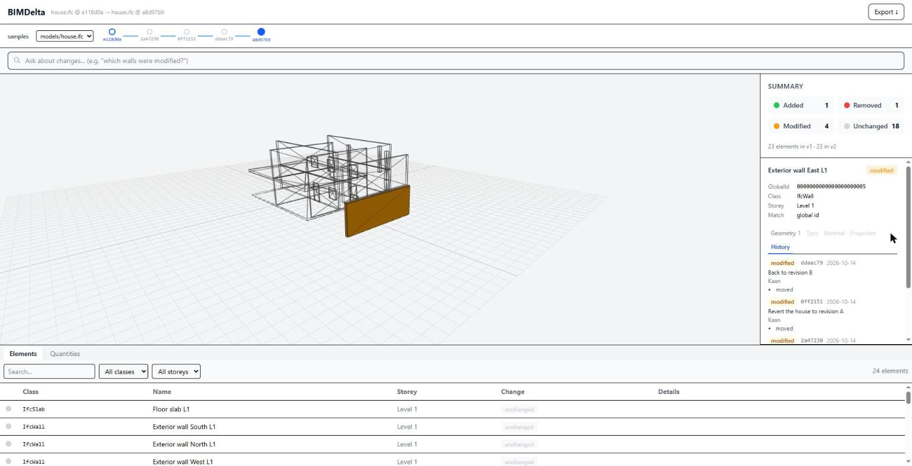
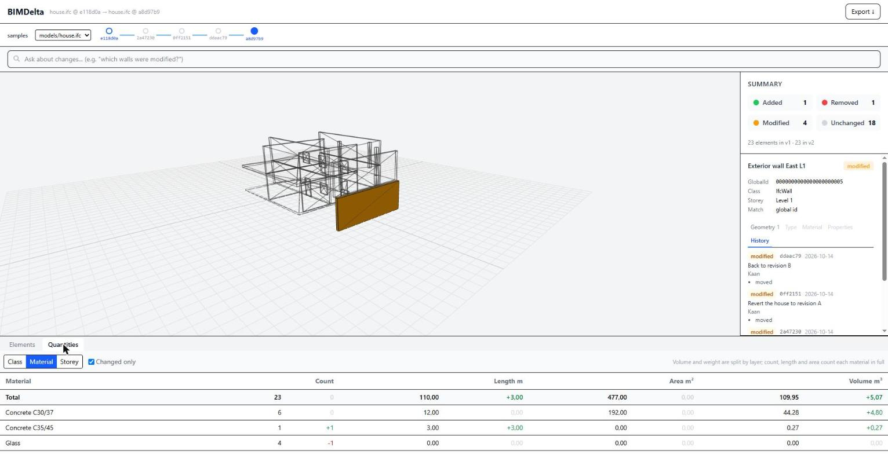
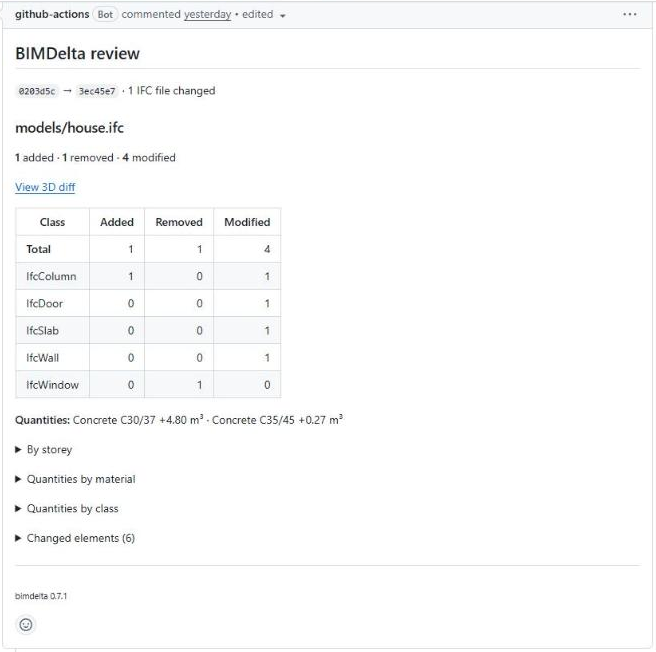
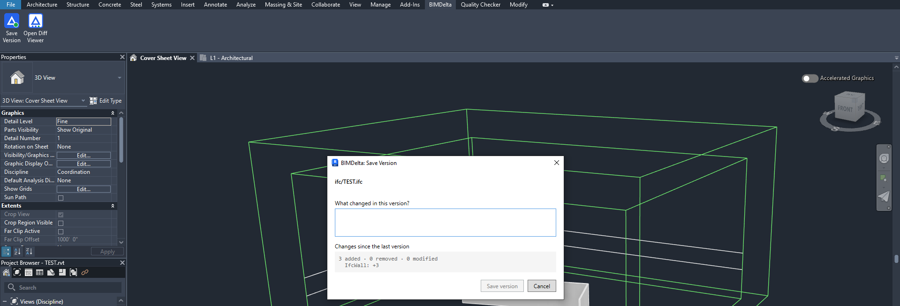

<p align="center">
  <h1 align="center">BIMDelta</h1>
  <p align="center">
    Code review for building models.
  </p>
</p>

<p align="center">
  <a href="https://bimdelta.vercel.app/">Web viewer</a> ·
  <a href="https://github.com/kaan36875/bimdelta-samples/pulls?q=is%3Apr">Example pull requests</a> ·
  <a href="docs/cli.md">Docs</a> ·
  <a href="https://pypi.org/project/bimdelta/">PyPI</a>
</p>

<p align="center">
  
</p>

BIMDelta turns IFC changes into reviewable diffs. When a model changes, it tells you which
elements were added, removed or modified, what changed on each of them (properties, type,
material, placement, geometry), how the quantities moved, and who changed what, and in which
commit. It works where the model lives: in Git, in a GitHub pull request, and in Revit.

- **A command line and a Git diff driver.** `git diff model.ifc` prints element changes instead
  of STEP text; `bimdelta blame` lists the commits that touched one element.
- **A GitHub Action** that comments on every pull request that changes a model: counts per
  class and storey, quantity deltas, the changed elements, and a link that opens both versions
  in the 3D viewer.
- **A Revit add-in.** *Save Version* exports the model to IFC and commits it; *Share for
  Review* pushes the versions to GitHub on a branch and opens the pull request form; *Open Diff
  Viewer* shows the history on a timeline, with every version that changed an element.
- **Quantity deltas and parallel-edit checks.** `bimdelta quantities` compares the take-off by
  class, material or storey; `bimdelta conflict` lists elements two branches both changed.

It is built on [IfcOpenShell](https://ifcopenshell.org). It is not a replacement for `ifcdiff`
or `ifcmerge`; it is the review layer on top of a model's version history.

<table>
  <tr>
    <td width="50%">
      
      <p align="center"><strong>History</strong>: every commit that changed the selected wall</p>
    </td>
    <td width="50%">
      
      <p align="center"><strong>Quantities</strong>: the take-off change by material</p>
    </td>
  </tr>
</table>

## Prior art

Comparing IFC versions is not new, and BIMDelta owes a lot to these:

| Tool | What it does | How BIMDelta relates |
|---|---|---|
| [IfcOpenShell `ifcdiff`](https://docs.ifcopenshell.org/ifcdiff.html) | Element-level IFC diff on the command line and in Bonsai | Same engine underneath (IfcOpenShell); BIMDelta adds noise filtering for re-exports, Git and pull request integration, quantities and the viewer |
| [`ifcmerge`](https://github.com/brunopostle/ifcmerge) | Three-way merge of IFC files, usable as a Git merge tool | BIMDelta does not merge; `bimdelta conflict` reports, `ifcmerge` resolves |
| [Bonsai](https://bonsaibim.org) | Native IFC authoring in Blender, with a Git panel | BIMDelta targets IFC exported from other tools, Revit first, reviewed on GitHub |
| [Speckle](https://speckle.systems) | A data platform with versioned model streams and connectors | BIMDelta keeps models in plain Git repositories, with no server of its own |
| Autodesk Docs / ACC *Compare versions*, Navisworks, Solibri | Visual version comparison and clash detection | Those are platform or desktop tools; BIMDelta runs in CI and in pull requests. It does no clash detection |

## Quick start

### Command line and Git

```bash
pip install bimdelta
bimdelta diff rev-a.ifc rev-b.ifc                    # table; -f markdown or -f json
bimdelta install-git-driver                          # once per clone
git diff HEAD~1 -- model.ifc                         # element changes instead of STEP text
bimdelta blame 0EubtQigr1vhxE6wY0hhn3                # commits that added or changed an element
bimdelta quantities HEAD~1:model.ifc HEAD:model.ifc  # take-off of two committed versions
bimdelta conflict feature/structure feature/facade   # elements changed on both branches
bimdelta serve                                       # the repository's history in the viewer
```

```text
$ git diff HEAD~1 -- model.ifc
### BIMDelta: model.ifc

| Class | Added | Removed | Modified | Unchanged |
|---|---:|---:|---:|---:|
| **Total** | 0 | 25 | 0 | 1303 |
| IfcBeam | 0 | 20 | 0 | 914 |
| IfcWall | 0 | 5 | 0 | 54 |

**Quantities:** Concrete, Cast-in-Place gray -108.55 m³
```

See the [CLI reference](docs/cli.md) and [Git integration](docs/git-integration.md).

### Pull request review

```yaml
# .github/workflows/bimdelta.yml
name: BIMDelta
on:
  pull_request:
    paths: ["**/*.ifc", "**/*.IFC"]
permissions:
  contents: read
  pull-requests: write
jobs:
  review:
    runs-on: ubuntu-latest
    steps:
      - uses: actions/checkout@v4
        with:
          lfs: true
      - uses: kaan36875/BIMDelta/apps/github-action@v0.7.1
```

See the [GitHub Action](docs/github-action.md) and the
[example pull requests](https://github.com/kaan36875/bimdelta-samples/pulls?q=is%3Apr).

<p align="center">
  
</p>

### Revit

```powershell
pip install bimdelta
git clone https://github.com/kaan36875/BIMDelta && cd BIMDelta\revit
.\install.ps1
```

Revit 2024 to 2027. See [the add-in guide](docs/revit-addin-install.md).

<p align="center">
  
</p>

### Working to ISO 19650

Feature branches as *work in progress*, pull requests as the check-review-approve gate into
*shared*, tags as *published* revisions: [ISO 19650 and a Git workflow](docs/iso-19650-mapping.md).

## How it works

1. **Parse.** Both IFC files are read with IfcOpenShell: elements, properties, quantities,
   materials, placements and storeys.
2. **Match.** Elements are paired by GlobalId, then by the authoring tool's element id in
   `IfcElement.Tag`, then by class, name and storey within 50 mm, so a re-export that
   regenerated GlobalIds still lines up ([element identity](docs/globalid-stability.md)).
3. **Filter.** Differences that come from export settings rather than from the design
   (property sets present in only one file, volatile metadata) are reported once instead of on
   every element ([noise filter](docs/noise-filter.md)). A model exported twice without changes
   gives an empty diff; this is tested against recorded Revit exports.
4. **Compare.** Matched pairs are compared across properties, type, material, placement, storey
   and geometry. Geometry is compared by a hash of its IFC definition first and only
   tessellated when that differs.
5. **Take off.** Quantity sets are totalled per class, material and storey for both versions.

## Performance

Measured on a laptop with public sample models, using [`scripts/benchmark.py`](scripts/benchmark.py).
The revisions were generated with [`scripts/make_revision.py`](scripts/make_revision.py), which
applies a known set of edits to 2 % of the elements per edit type (moved, property changed,
reshaped, deleted, GlobalId regenerated); the diff matched the expected result element for
element, except where geometry could not be evaluated, which is reported.

| Model | Authoring tool | Size | Elements | Diff, unchanged | Diff, revision | Peak memory |
|---|---|---|---|---|---|---|
| Duplex | Revit 2011 | 2.3 MB | 218 | 1.3 s | 1.3 s | 110 MB |
| Advanced model | Revit 2021 | 34 MB | 6,442 | 21 s | 20 s | 710 MB |
| Schependomlaan | ArchiCAD | 47 MB | 3,621 | 22 s | 22 s | 940 MB |

Both files are held in memory, so peak memory is roughly 20× the file size. The command line
has no size limit; the hosted viewer accepts files up to 50 MB.

## Repository layout

```
packages/bimdelta-core/   Diff engine and quantity take-off (PyPI: bimdelta-core)
apps/cli/                 bimdelta command, Git driver, review, blame, conflict, serve (PyPI: bimdelta)
apps/github-action/       Pull request review action
apps/server/              FastAPI service behind the hosted viewer
apps/web/                 React + three.js viewer
revit/                    Revit add-in (C#)
docs/                     Guides
samples/roundtrip/        Recorded Revit export pairs for the round-trip tests
scripts/                  Benchmark, sample and release tools
```

## Development

```bash
python -m venv .venv && . .venv/Scripts/activate      # macOS/Linux: . .venv/bin/activate
pip install -e "packages/bimdelta-core[dev]" -e "apps/server[dev]" -e "apps/cli[dev]"
pytest packages/bimdelta-core apps

uvicorn bimdelta_server.main:app --port 8001          # API
cd apps/web && npm install && npm run dev             # viewer on http://localhost:5173
```

`docker compose up --build` runs both (viewer on port 3000, API on 8001). The add-in builds
with the .NET SDK: `dotnet build revit/BIMDelta.Revit/BIMDelta.Revit.csproj -p:RevitVersion=2027`.

As a library:

```python
from bimdelta_core import load_settings, run_diff

result = run_diff("rev-a.ifc", "rev-a.ifc", "rev-b.ifc", "rev-b.ifc", load_settings())
print(result.summary.added, result.summary.removed, result.summary.modified)
print(result.quantities.total.delta.volume)
```

## License

MIT
