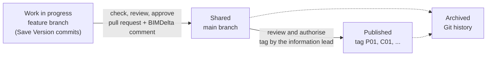

# ISO 19650 and a Git workflow

ISO 19650 organises project information in a *common data environment* (CDE) where each
information container (a model, a drawing, a schedule) moves through four states. A Git
repository with protected branches, pull requests and tags can play that role for IFC models.
This page shows one way to map the two. It is an interpretation, not a certified CDE, and
teams will reasonably draw some lines differently.

## The mapping



| ISO 19650 | Git and BIMDelta | Who |
|---|---|---|
| **Information container** | One IFC file under version control, e.g. `ifc/structure.ifc` | |
| **Work in progress** (WIP): visible to the task team only | A branch per task or package, e.g. `wip/structure-level-3`. Each **Save Version** in Revit is a commit | Task team |
| WIP versions (P01.1, P01.2 in the UK National Annex) | Commits on the branch; `bimdelta blame` and the viewer timeline show them per element | |
| **Check, review and approve** before sharing | A **pull request** into `main`. The BIMDelta Action posts what changed (counts, quantities, 3D link); a required review is the approval | Task team leader |
| **Shared**: available to the other task teams for coordination | `main`. Branch protection means nothing reaches it without the approved pull request | All task teams |
| Suitability (e.g. S1 *suitable for coordination*) | A pull request label or a line in the merge commit, by team convention | |
| Parallel work by several task teams | `bimdelta conflict` before merging shows elements changed on two branches | |
| **Review and authorise** for publication | The information lead creates a tag on a `main` commit | Lead appointed party, then the appointing party |
| **Published** revisions (P01, P02 preliminary; C01 contractual) | Annotated tags `P01`, `C01`, optionally a GitHub release with the IFC attached | |
| **Archived**: superseded, kept for the record | Every earlier commit and tag. Protected branches and tags keep the history from being rewritten | |
| Audit trail | Commit author and time, pull request reviews, tag author | |

## A worked cycle

```bash
# WIP: the structural team works on a branch
git switch -c wip/structure-level-3
#   ... Save Version in Revit, several times ...
git push -u origin wip/structure-level-3

# Before asking for review: did the facade team touch the same elements?
bimdelta conflict wip/structure-level-3 origin/wip/facade

# Check, review, approve: open a pull request into main.
# The BIMDelta Action comments with the element changes and the quantity deltas;
# the task team leader approves and merges. The model is now Shared.

# Review and authorise: the information lead publishes the shared state
git switch main && git pull
bimdelta quantities P01:ifc/structure.ifc HEAD:ifc/structure.ifc --changed-only
git tag -a P02 -m "P02: Stage 3 structure, suitable for coordination"
git push origin P02
```

Between published revisions, `bimdelta review P01 P02` produces the same summary as the pull
request comments, for a transmittal or a revision note.

## Setting up the repository

- **Protect `main`**: require a pull request, at least one approving review and the BIMDelta
  workflow as a status check, so the change summary is there before anyone approves. Block
  force pushes.
- **Protect tags** matching `P*` and `C*` so only the information lead can create them and no
  one can move them.
- **Name branches** by state and package, e.g. `wip/<package>-<topic>`, so the state is
  visible in the branch list.
- Keep the `.rvt` out of the repository (the Revit add-in writes a `.gitignore` for it). The
  IFC export is the information container that is shared; the authoring file stays with the
  task team.

## What Git does not give you

- **Per-container access.** Access is granted per repository. Where a task team must not see
  another's WIP, use separate repositories (or forks) per team and share through pull requests.
- **Status metadata fields.** Suitability and revision codes live in labels, commit messages
  and tag names by convention, not in a validated field.
- **Container naming.** ISO 19650 naming (project, originator, volume, level, type, role,
  number) is up to you; Git does not check file names.
- **Large files.** Models over a few hundred MB need Git LFS, and hosting quotas apply.

## Further reading

- ISO 19650-1:2018, clause 12 (the common data environment) and ISO 19650-2:2018, clause 5.
- The UK BIM Framework guidance on ISO 19650, including the UK National Annex status and
  revision codes.
